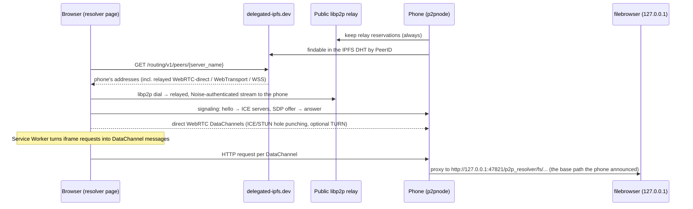

# P2P File Server for Android

Turn an old Android phone into a personal file server that you can open from
any browser, anywhere. You don't need a domain, a public IP, port forwarding or a
VPS. It is built from off-the-shelf parts:

| Part | What it does |
|---|---|
| [FileBrowser Quantum](https://github.com/gtsteffaniak/filebrowser) `v2.0.2-stable` | The file manager web UI and API. It runs on the phone, bound to `127.0.0.1` only. |
| [go-libp2p](https://github.com/libp2p/go-libp2p) + IPFS Amino DHT + public circuit relays | Gives the phone a permanent ID and makes it findable and reachable behind NAT/CGNAT. |
| [pion/webrtc](https://github.com/pion/webrtc) | Direct, encrypted browser↔phone data link that carries the HTTP traffic. |
| Kotlin / Jetpack Compose app | Start/stop, settings, share link + QR code, foreground service. |
| Static resolver page (`web/p2p_resolver/`) | Hosted for free on Neocities or GitHub Pages. A generic, app-agnostic P2P→HTTP resolver: it finds any server by PeerID and shows the web app that server exposes. No tokens, keys or app-specific settings are built in. |

The link you share looks like:

```
https://yourname.neocities.org/p2p_resolver/?server_name=12D3KooW…
```

`server_name` is the phone's libp2p PeerID. The app generates the key behind it on first
run and stores it only in its private storage. The ID doesn't change when the phone switches networks, only
when you tap **Advanced → Generate new identity**, which permanently invalidates the old link.

## How a visit works



- **libp2p only carries a few kilobytes of signaling.** Public relays are heavily
  rate-limited, so file data never goes through them. go-libp2p cannot do
  browser WebRTC hole punching (`/webrtc`), so the phone runs its own small
  signaling protocol over a libp2p stream and pion handles the WebRTC side.
- **Security:** the SDP answer arrives over a Noise channel that is
  cryptographically bound to the PeerID in the link. The browser therefore
  verifies the phone's DTLS certificate, and a relay cannot read or alter the
  traffic. Access to files is protected by filebrowser's own login.
- **Cookies:** a Service Worker can't set cookies, so the phone keeps a cookie jar
  per browser. It is keyed by a random ID in the page's `localStorage` and saved in the app's
  private storage (`-cookies`), so visitors stay logged in across restarts and network changes.
  Logging out still works, because the backend's cookie deletions are applied.
- **Remembered relay routes:** the page also keeps the server's relay addresses for a day. They
  are dialed together with whatever the DHT lookup finds. If the lookup is slow (over 8 s) or fails,
  the page goes ahead with the remembered routes alone, so `delegated-ipfs.dev` being slow or down
  doesn't block repeat visits.
- **Uploads:** in Chromium-based browsers request bodies are streamed from the Service Worker with
  4 MiB flow control, so even single huge uploads use little memory. Firefox and Safari don't expose
  request bodies as streams, so there each request body is buffered once. FileBrowser uploads in
  10 MB chunks, so either way is fine.
- **Versioning:** hello/config carry a protocol version (`v`). A page or server that is too old
  shows a clear "outdated, update it" message instead of failing obscurely.
- **Fast reconnects at home:** the public DHT drops private (LAN) addresses, so during signaling
  the phone also sends its current direct addresses. The page remembers up to three LAN
  WebRTC-direct addresses per server in `localStorage` for 30 days. On the next visit it tries
  them first, while the DHT lookup runs in parallel. On the same network it connects in about
  a second, with no lookup, relay or router hairpinning. Elsewhere those attempts just time out
  while the lookup finishes. Keep the P2P port fixed, because a changed port makes the
  remembered addresses useless.
- **Saved servers:** after a successful connect the page saves the server's ID and name in
  `localStorage`. Opening the page without `?server_name=` then shows a list to pick from, with
  **Forget** to remove an entry. The ID is the server's public key, and every connection is
  authenticated against it, so a saved entry always reaches the same server. The name is only a
  label. Servers that report no name are labelled with their web app's page title.
- **Flow control:** each response has a 4 MiB credit window that the browser acks
  as it consumes data. Video seeking and large downloads therefore don't buffer
  whole files in memory.

Wire formats are documented at the top of [go/signal.go](go/signal.go) and
[go/bridge.go](go/bridge.go).

## Repository layout

```
go/                 p2pnode: libp2p host, signaling, WebRTC↔HTTP bridge, filebrowser supervisor
android/            Kotlin app (Gradle). Executables are packaged as jniLibs/<abi>/lib*.so
web/src/            resolver page source (libp2p client, tunnel, UI logic)
web/p2p_resolver/   ready-to-upload static site: index.html, sw.js, resolver.js (built bundle)
scripts/            build-native.sh, build-web.sh, build-apk.sh
```

## Build

You need Go (go.mod asks for 1.26; `go` downloads that toolchain itself), JDK 17+,
the Android SDK with an NDK (for the `armeabi-v7a`/`x86_64` builds) and `curl`. Node.js 20+ is only needed if you change `web/src`.

```bash
scripts/build-apk.sh              # all ABIs → dist/app-<abi>-release.apk
scripts/build-apk.sh arm64-v8a    # only 64-bit ARM (most phones from 2017 on)
```

`build-native.sh` does three things:

- Cross-compiles `go/` for Android.
- Downloads the FileBrowser Quantum release binary for each ABI.
- Unpacks those binaries with UPX, which it fetches if `upx` isn't installed. The
  releases are UPX-packed, and unpacked binaries load more reliably on Android.

Both end up in `android/app/src/main/jniLibs/<abi>/`. Android only allows
apps to execute files from their native library directory, so the binaries are named `lib*.so`.

To sign with your own key, create `android/keystore.properties` (gitignored) with
`storeFile`, `storePassword`, `keyAlias` and `keyPassword`. Without it, debug and release
APKs are signed with your local Android debug key, so they still install directly.

## Host the resolver page

Upload the **folder** `web/p2p_resolver/`, keeping its name. It contains `index.html`, `sw.js`,
`resolver.js`, `manifest.json` and three icons. With the manifest and icons, browsers offer to
install the page as an app ("Add to Home screen"), which opens straight to your saved servers.

- **Neocities:** create the folder `p2p_resolver` in your site's root and upload the
  files. URL: `https://yourname.neocities.org/p2p_resolver/`
- **GitHub Pages:** commit `p2p_resolver/` to the published branch or folder. URL:
  `https://you.github.io/repo/p2p_resolver/`

The page is generic. During signaling the server announces the path its web app is served under, and the
page's Service Worker tunnels every request in its folder except the page's own files (`index.html`,
`sw.js`, `resolver.js`). The announced path must therefore be a sub-folder of where the page is hosted. The
Android app uses `<resolver folder>/fs/`, which it works out from the resolver URL you enter. The page refuses
to connect with a clear message if the paths don't match. The same hosted page can open any number of
servers running any HTTP app. Give the page its own folder, because it takes over the folder's other paths.
The page needs HTTPS (or `localhost`), which both hosts provide.

Protocol identifiers are generic: signaling uses `/p2p-http/signal/1.0.0`, and the DHT fallback provider
record is `CIDv1(raw, sha256("p2p-http:" + PeerID))`. Neither is a secret.

## Set up the phone

1. Install the APK for the phone's CPU type (`adb install dist/app-arm64-v8a-release.apk`).
2. Open the app and grant what the **Setup** card asks for:
   - **All files access**, to share folders.
   - **No battery restrictions**, so Android doesn't freeze the server.
   - **Notifications**.
3. In **Settings**, enter the resolver page URL and pick the folder to share.
4. Tap **Start server**. After 10–60 s the status turns **Online**. It can take another
   minute or two before a brand-new server ID is findable.
5. Share the link or QR code, together with the login shown in the app. The server identity
   (the key behind the server ID) is created on first launch. **Advanced → Generate new identity**
   replaces it after a warning. Use it if a link leaked, and note that the old link stops working forever.
   **Advanced → Back up… / Restore…** saves the identity to a passphrase-encrypted file
   (AES-256-GCM, PBKDF2), so you can keep the same server ID and links on a new phone. The password
   is generated on first launch, and you can change it.

The phone is a server now, so keep it on a charger and on Wi-Fi.
**Start when the phone boots** brings it back after a reboot.

## Debugging

- **App → Log** shows output from the node and from filebrowser.
- Resolver URL switches:
  - `&via=relay` forces the relayed path.
  - `&addr=<multiaddr>` (repeatable) adds addresses by hand, for example to test on the same LAN.
  - `&router=https://…` (repeatable) adds delegated-routing endpoints to try after
    `delegated-ipfs.dev`, for example a self-hosted [someguy](https://github.com/ipfs/someguy).
- You can run the node on a desktop, with any Linux filebrowser binary as the child:
  ```bash
  cd go && go run . -gen-key -key /tmp/id.key     # once; prints the PeerID (-print-id shows it again)
  go run . -key /tmp/id.key -base /p2p_resolver/fs/ -target http://127.0.0.1:8086 -- /path/to/filebrowser -c config.yaml
  ```
  The node never creates a key on its own. Any HTTP app works as the backend, as long as it serves under
  the `-base` path. For filebrowser that means `http.baseURL` must be `/p2p_resolver/fs/`. Serve `web/` on `http://localhost:8099` and open
  `http://localhost:8099/p2p_resolver/?server_name=<printed PeerID>`.

## Limitations

- **Very strict NATs:** if *both* the phone and the visitor are behind symmetric NAT (some mobile
  carriers), WebRTC hole punching fails. Add a TURN server under **Advanced**. The app passes it to the
  browser automatically.
- **Single points of failure:** first-time discovery uses `delegated-ipfs.dev`, and signaling from outside
  the LAN depends on whichever public IPFS relays are available. Both are free community
  infrastructure with no SLA. Repeat visits soften this with remembered LAN and relay addresses.
- **Throughput:** file speed is limited by the phone's upload speed and by pion's SCTP. A loopback test
  reached about 27 MB/s for downloads and about 9 MB/s for uploads.
- **Browsers:** the page needs Service Workers, which Firefox disables in private windows.
- **Login rate limit:** every request reaches filebrowser from `127.0.0.1`, so its failed-login lockout
  applies to all visitors at once.
# p2p_fileserver
